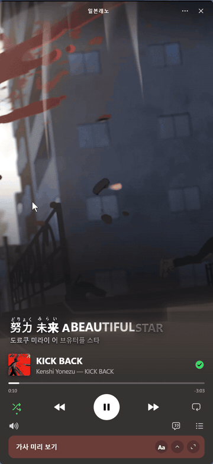
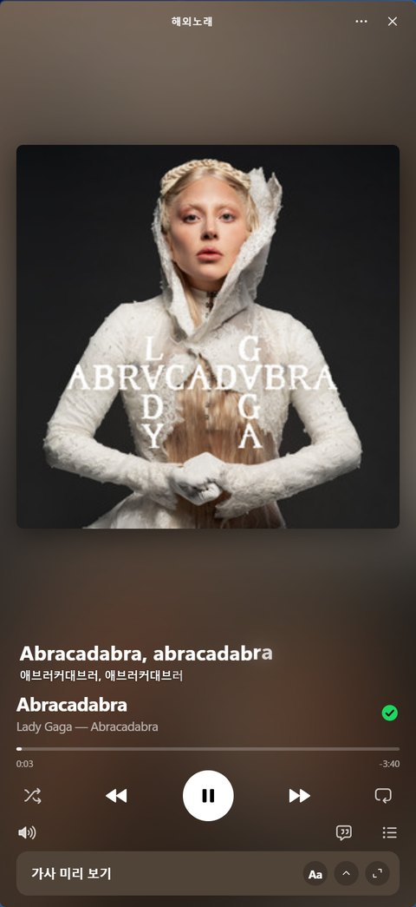
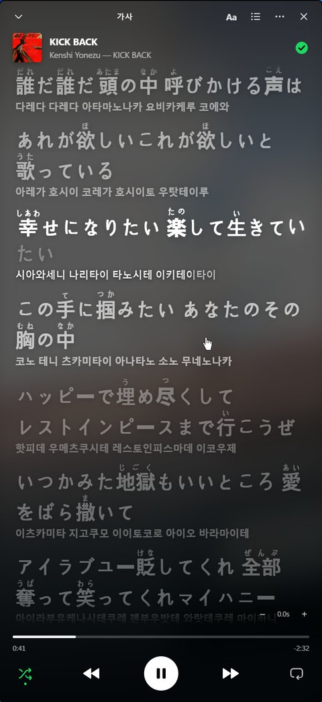
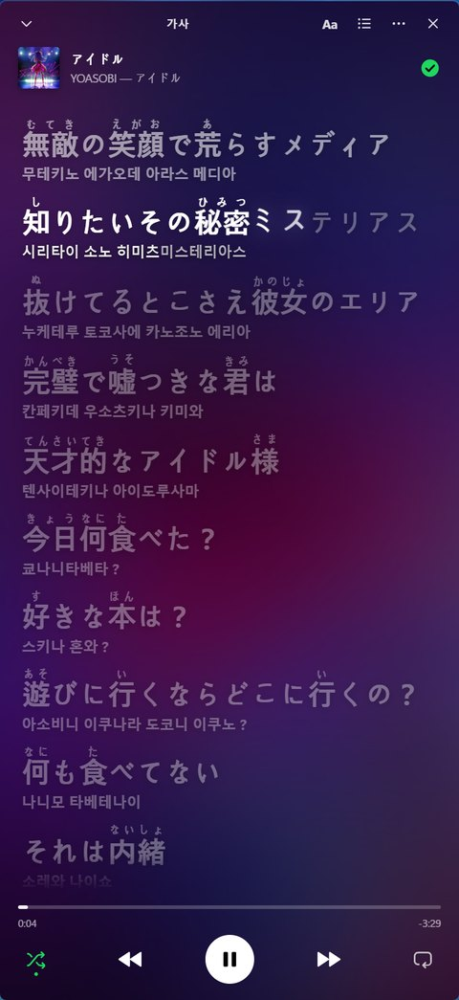
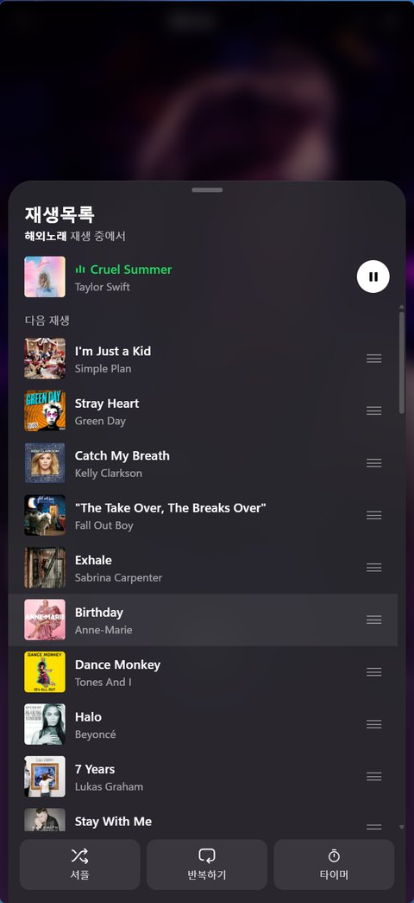
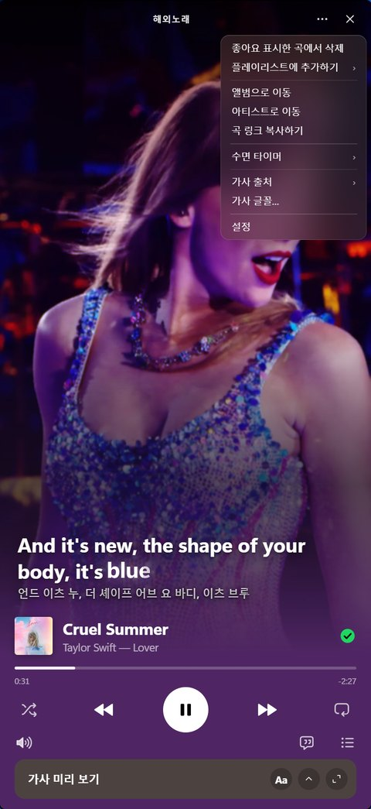
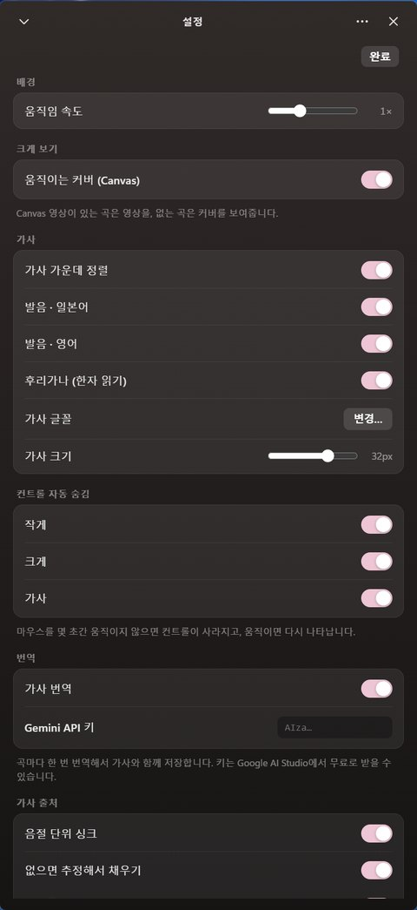
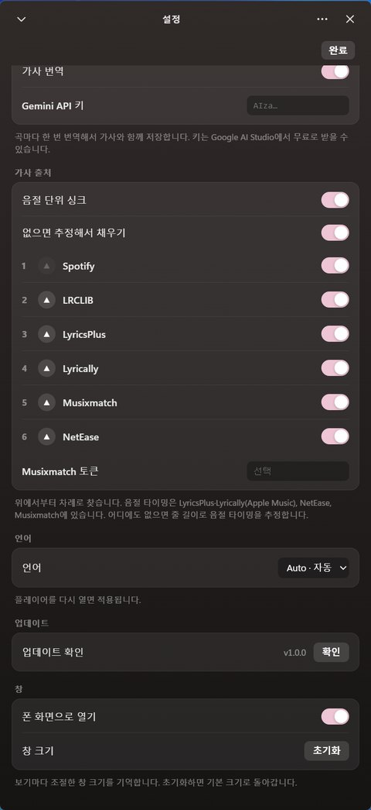

# Wave Player Mobile

[English](README.md) · **한국어** · [日本語](README.ja.md) · [简体中文](README.zh-CN.md) · [Español](README.es.md)

Spotify 데스크톱 앱에서 **모바일 스포티파이 화면**을 그대로 쓰는 미니 플레이어입니다.
[Wave Player](https://github.com/03x1/Wave-Player)(Spicetify 확장)를 바탕으로 만들었습니다.

<p align="center">
  
</p>

## 화면

### 폰 화면

미니 플레이어를 열면 기본으로 나오는 화면입니다. 캔버스 영상이나 앨범 커버 위에 현재 가사 한 줄이 뜨고, 아래에 컨트롤과 가사 미리 보기 카드가 있습니다.

<table>
  <tr>
    <td align="center"></td>
    <td align="center"></td>
    <td align="center"></td>
  </tr>
  <tr>
    <td align="center">가사 미리 보기 펼침</td>
    <td align="center">가사 미리 보기 접음</td>
    <td align="center">앨범 커버로 전환</td>
  </tr>
</table>

- 앨범 표지를 누를 때마다 **캔버스 영상 ↔ 커버**가 바뀝니다. 커버일 때는 애플뮤직처럼 커버 색이 천천히 움직이는 배경이 깔립니다.
- 가사 미리 보기 카드는 ⌄ / ⌃ 로 접고 펼칠 수 있습니다.

### 가사 전체화면

<table>
  <tr>
    <td align="center"></td>
    <td align="center"></td>
  </tr>
  <tr>
    <td align="center">캔버스가 있는 곡</td>
    <td align="center">캔버스가 없는 곡 (흐린 커버)</td>
  </tr>
</table>

- 캔버스가 있으면 캔버스를, 없으면 애플뮤직처럼 흐린 커버를 배경으로 씁니다. 단색 배경도 고를 수 있습니다.
- 부르는 음절이 살짝 커지면서 채워지고, 전주와 간주에는 `• • •`가 표시됩니다.
- 일본어 가사에는 한자 위에 **후리가나**가, 가사 아래에는 **발음**이 붙습니다. 발음 줄도 음절에 맞춰 채워집니다.

### 재생목록 · 메뉴

<table>
  <tr>
    <td align="center"></td>
    <td align="center"></td>
  </tr>
  <tr>
    <td align="center">재생목록 (드래그로 순서 변경, 셔플·반복·타이머)</td>
    <td align="center">⋯ 메뉴 (앨범·아티스트 이동, 수면 타이머, 가사 출처, 설정)</td>
  </tr>
</table>

### 설정

<table>
  <tr>
    <td align="center"></td>
    <td align="center"></td>
  </tr>
  <tr>
    <td align="center">배경 · 가사 · 컨트롤 자동 숨김 · 번역</td>
    <td align="center">가사 출처 순서 · 언어 · 업데이트 · 창</td>
  </tr>
</table>

## 주요 기능

- **음절 싱크**: 부르는 음절이 살짝 커지면서 채워집니다. 전주와 간주에는 `• • •`가 표시됩니다.
- **발음**: 한국어 화면에서는 일본어(kuromoji)와 영어(CMU 발음사전) 가사 아래에 한글 발음을, 다른 언어 화면에서는 일본어 가사 아래에 로마자(romaji)를 붙입니다.
- **후리가나**: 한자 위에 히라가나 읽기를 표시합니다.
- **AI 번역**: Gemini API 키를 넣으면 가사 아래에 화면 언어로 번역이 붙습니다. 곡마다 한 번 번역해서 저장합니다.
- **가사 출처**: Spotify, LRCLIB, LyricsPlus·Lyrically(Apple Music 음절 가사), NetEase, Musixmatch에 동시에 요청하고 가장 좋은 가사를 고릅니다. 설정에서 출처 순서를 바꾸거나 끌 수 있고, 곡마다 출처를 직접 고정할 수도 있습니다. 음절 타이밍이 어디에도 없으면 줄 길이로 추정해서 채웁니다(설정에서 끌 수 있음). 한 번 받은 가사는 디스크에 저장돼 다음부터 바로 나옵니다.
- **화면 언어**: 한국어, English, 日本語, 简体中文, Español. 기본값은 Spotify 언어를 따르고, 설정 → 언어에서 바꿀 수 있습니다.
- **기타**: 아티스트·크레딧 카드, 가사 글꼴 설정(Aa), 수면 타이머, 곡 링크 복사를 지원합니다.

## 설치

Spotify 데스크톱 앱이 필요합니다. 아래 명령은 Spicetify가 없으면 함께 설치합니다.
같은 명령을 다시 실행하면 최신 버전으로 업데이트됩니다.

**Windows (PowerShell)**

```powershell
iwr -useb https://raw.githubusercontent.com/w2story/wave-player-mobile/main/install.ps1 | iex
```

**macOS / Linux (터미널)**

```sh
curl -fsSL https://raw.githubusercontent.com/w2story/wave-player-mobile/main/install.sh | sh
```

### 직접 설치

1. Spicetify Marketplace에서 기존 **Wave Player를 제거**합니다. 둘 다 있으면 하나만 동작합니다.
2. `waveplayer-mobile.js`를 Spicetify 확장 폴더에 넣습니다.
   - Windows: `%APPDATA%\spicetify\Extensions`
   - macOS / Linux: `~/.config/spicetify/Extensions`
3. 아래 명령을 실행합니다.

```sh
spicetify config extensions waveplayer-mobile.js
spicetify apply
```

`Config "extensions" unchanged ... already in the list` 경고는 이미 등록돼 있다는 뜻이라 무시해도 됩니다.

## 사용법

| 동작 | 방법 |
| --- | --- |
| 미니 플레이어 열기 | Spotify의 미니 플레이어 버튼 또는 `Ctrl+Shift+M` |
| 캔버스 ↔ 커버 | 앨범 표지 클릭 |
| 가사 전체화면 | 가사 미리 보기 카드 클릭, 또는 `L` |
| 가사 미리 보기 접기/펼치기 | 카드 상단의 ⌄ / ⌃ |
| 가사 글꼴·배경 | 카드 상단의 **Aa** |
| 재생목록 | 컨트롤 오른쪽의 목록 버튼 |
| 설정 | 오른쪽 위 **⋯** → 설정 |
| 곡 링크 복사 | 초록 체크에 마우스를 올리면 나오는 링크 버튼, 또는 **⋯** → 곡 링크 복사하기 |
| 가사 싱크 보정 | `[` / `]` (곡별 저장) |
| 폰 화면 ↔ 커버 화면 | `M` |

## 알아둘 점

- 미니 플레이어 창은 Spotify에 내장된 Chrome의 제한으로 **화면 높이의 80%까지만** 커집니다.
- 발음 사전은 처음 쓸 때 한 번 내려받습니다(일본어 약 12MB, 영어 약 5MB).
- 아티스트·크레딧 카드와 캔버스는 Spotify 앱 내부 API를 쓰기 때문에, Spotify 버전에 따라 동작이 달라질 수 있습니다.

## 크레딧

- 원본: [Wave Player](https://github.com/03x1/Wave-Player) (MIT)
- 가사: [LRCLIB](https://lrclib.net), LyricsPlus(KPoe), [Lyrically](https://lyrics.paxsenix.org)(Paxsenix), NetEase, Musixmatch, Spotify
- 일본어 읽기: [kuromoji.js](https://github.com/takuyaa/kuromoji.js) · 영어 발음: [CMU Pronouncing Dictionary](https://github.com/words/cmu-pronouncing-dictionary)
- 번역: Google Gemini API (사용자 본인 키)

MIT 라이선스입니다. 원본 저작권 표기는 [LICENSE](LICENSE)에 그대로 남아 있습니다.
